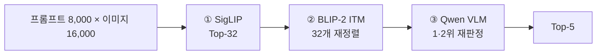

# HAIKUTHON Team 16

**2026 HAIKUTHON · Multimodal RAG 이미지 검색 · 우수상**

영문 프롬프트에 가장 잘 맞는 이미지 5장을 후보 이미지 중에서 찾아 순서대로 반환하는 과제입니다.

## 과제

| 항목 | 내용 |
| --- | --- |
| 평가 | (Recall@1 + NDCG@5) / 2 |
| 데이터 | 학습 4,000쌍 공개 ([KimWooJin/26-haikuthon-train](https://huggingface.co/datasets/KimWooJin/26-haikuthon-train)), 테스트는 프롬프트 8,000개 × 이미지 16,000장 |
| 제약 | 제공 데이터만 사용, 외부 API 금지, 테스트 항목마다 독립 예측, 서버 추론 약 15분 |

## 핵심 발견

틀린 1위 예측의 **97%** 가 장면·스타일은 같고 색·위치 관계·자세·개수 중 두세 가지만 다른 **"형제" 이미지**와 헷갈린 경우였습니다. SigLIP은 정답을 8위 안에는 99.8% 넣었지만 1위로는 25.7%만 골랐습니다. 그래서 문제를 **"형제 중 정확히 하나 고르기"** 로 다시 정의했습니다.

## 방법

- **학습:** BLIP-2 Q-Former를 형제 이미지, 형제의 실제 프롬프트, 규칙으로 만든 오답 문장(색·개수 교체, 위아래·좌우 반전), 좌우 반전 이미지 짝으로 fine-tuning했습니다.
- **추론:** 모든 프롬프트의 1~5위 → 6~10위 → … 순서로 재정렬하고, 시간 예산(840초)이 끝나면 끝낸 묶음까지만 씁니다. ViT-g 특징은 이미지당 한 번만 계산하고 fp16으로 실행합니다.
- **검증:** 4,000장 전체를 후보로 두는 검증을 만들어 공개 점수와 맞췄습니다(검증 0.257, 공개 0.27).
- **규칙 준수:** 프롬프트 간 정규화(dual softmax)는 R@1을 5.8%p 올렸지만 독립 예측 규칙 때문에 쓰지 않았습니다.

## 결과

| 제출 | R@1 | R@5 | NDCG@5 | 평균 |
| --- | --- | --- | --- | --- |
| 첫 제출 (SigLIP + BLIP-2, 후보 5개) | 0.2725 | 0.4644 | 0.3826 | 0.3275 |
| 최종 제출 <!-- TODO --> | | | | |

## 실행

Colab에서 `colab/haikuthon_train_colab_kimth.ipynb`를 열고 GPU 런타임을 선택합니다. `CODE_ZIP`(예: `starter_kit_kimth_v5.zip`)과 `TRAIN_ARGS`를 정해 모두 실행하면, Drive의 `haikuthon/outputs/<날짜_시각>/`에 `submission.zip`이 저장됩니다.

## 팀

<!-- TODO: 팀원과 역할 -->
